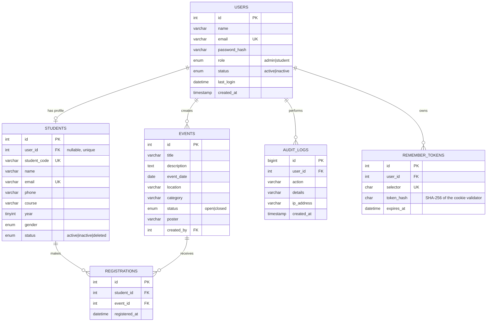

# ER Diagram – StudentHub

**Normalisation:** every table is in 3NF – a student's login data lives in `users`, academic data in `students`,
and the many-to-many relation between students and events is resolved by `registrations`
(with a unique key on `student_id + event_id`).

**Keys / rules:** `registrations` rows are removed automatically when a student or event is deleted (`ON DELETE CASCADE`);
`audit_logs.user_id` and `events.created_by` become `NULL` if a user is removed (`ON DELETE SET NULL`) so history is kept.
